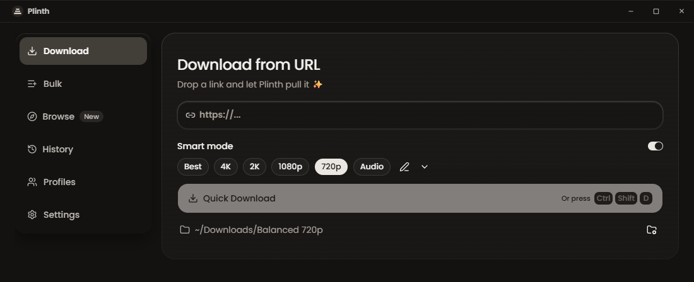
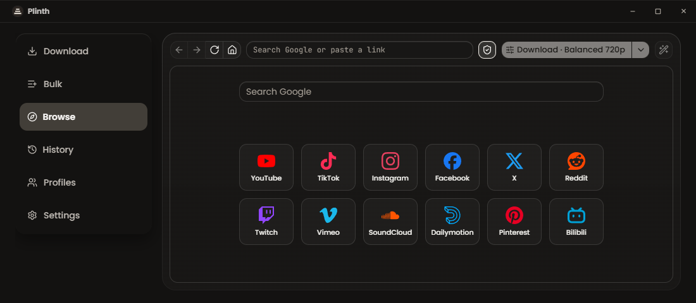
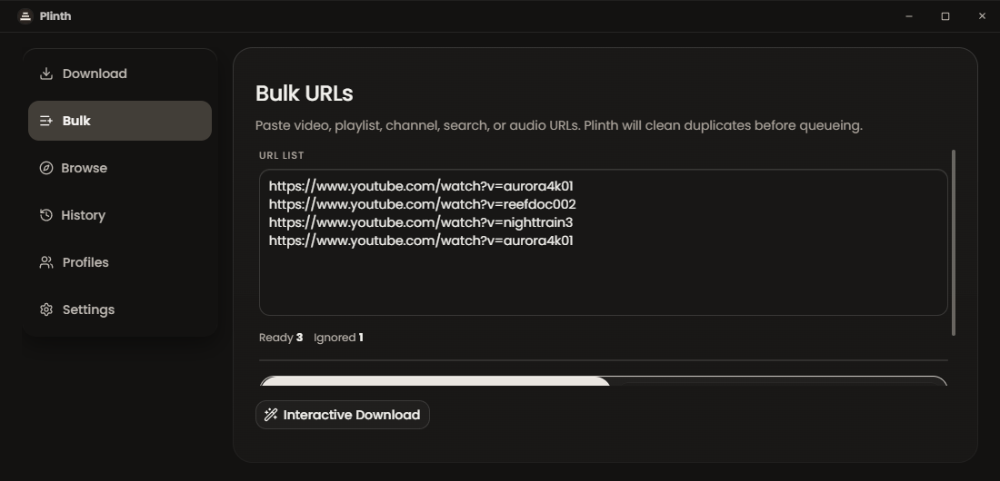
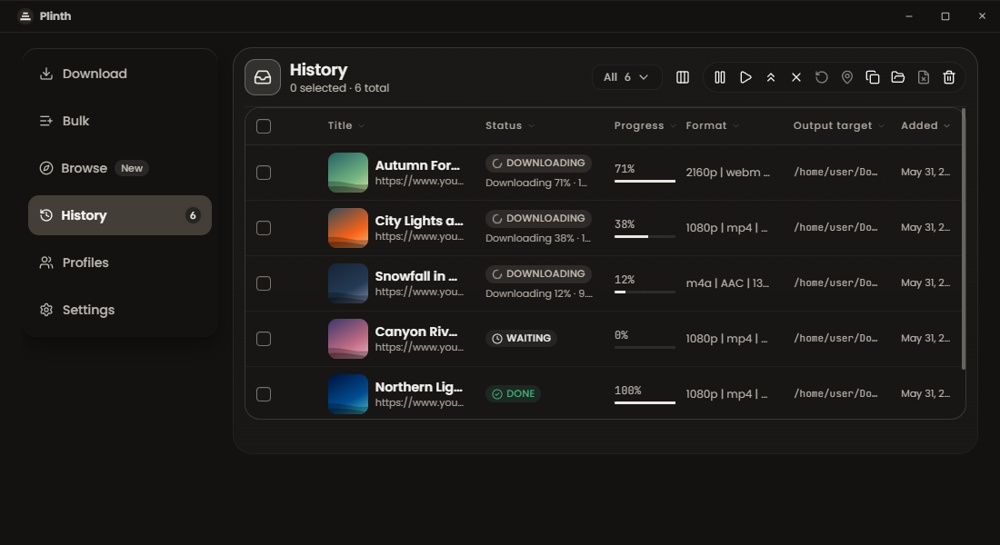
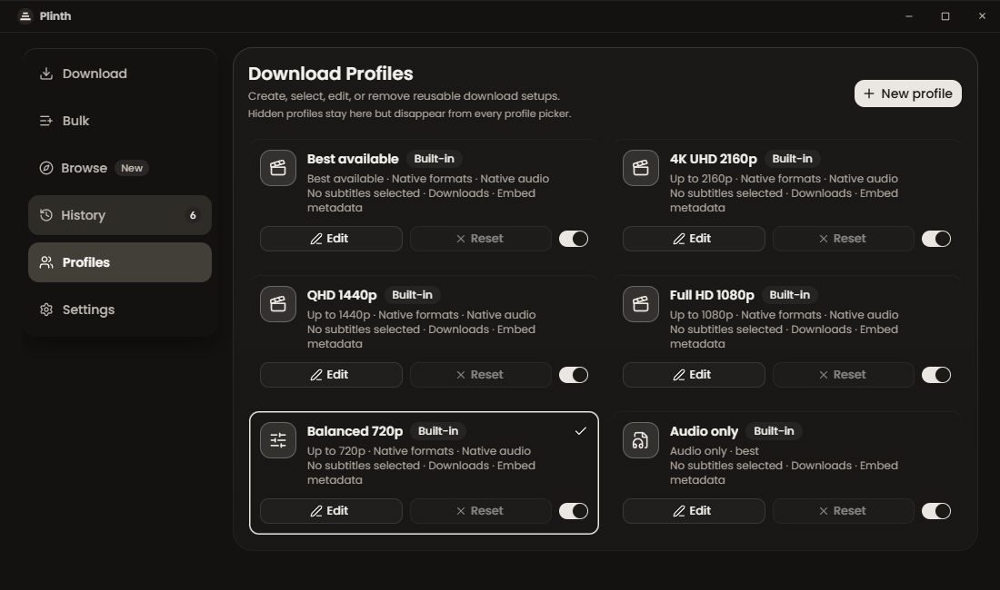
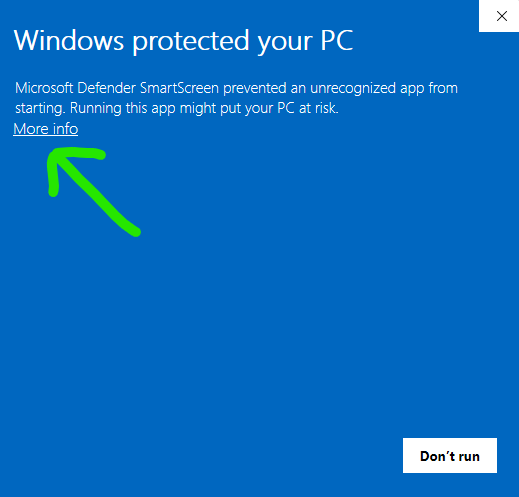
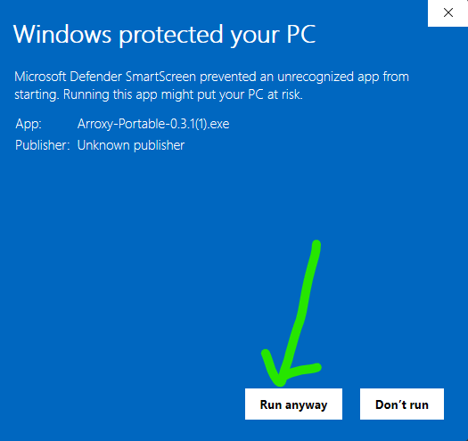

# Plinth — Kipakuzi Bure cha Chanzo Wazi cha YouTube (+ Tovuti 2000) kwa Windows, macOS na Linux

Pakua video, Shorts, muziki, vituo, podikasti, au nyimbo za sauti kutoka **YouTube na tovuti 2000+ zinazotumika** — hadi 4K HDR kwa fps 60, au kama MP3 / AAC / Opus. Inafanya kazi mahali hapo kwenye Windows, macOS, na Linux. **Hakuna matangazo, hakuna mzigo wa ziada, hakuna mauzo ya ziada.**

**Soma kwa:** [Afaan Oromoo](README.om.md) · [Bahasa Indonesia](README.id.md) · [Deutsch](README.de.md) · [English](../../README.md) · [Español](README.es.md) · [Français](README.fr.md) · [Italiano](README.it.md) · **Kiswahili** · [O'zbekcha](README.uz.md) · [Polski](README.pl.md) · [Português](README.pt.md) · [Tiếng Việt](README.vi.md) · [Türkçe](README.tr.md) · [አማርኛ](README.am.md) · [العربية](README.ar.md) · [اردو](README.ur.md) · [پښتو](README.ps.md) · [فارسی](README.fa.md) · [বাংলা](README.bn.md) · [हिन्दी](README.hi.md) · [ไทย](README.th.md) · [မြန်မာဘာသာ](README.my.md) · [Ελληνικά](README.el.md) · [Русский](README.ru.md) · [Српски](README.sr.md) · [Українська](README.uk.md) · [中文](README.zh.md) · [日本語](README.ja.md) · [한국어](README.ko.md) · [繁體中文](README.zh-Hant.md)

[**↓ Pakua Toleo la Hivi Karibuni**](#install) · [**Tovuti**](https://plinth.fabwaseem.com) · [Uzinduzi wa kwanza wa Windows](#windows-first-launch) · [Uzinduzi wa kwanza wa macOS](#macos-first-launch) · [Uzinduzi wa kwanza wa Linux](#linux-first-launch)

Ikiwa Plinth inakuokoa muda, ⭐ inasaidia wengine kuipata.

_Last updated: 2026-10-18._

Plinth is a free desktop app for Windows, macOS, and Linux. It saves video, audio, playlists, and subtitles from YouTube and 2000+ other [yt-dlp](https://github.com/yt-dlp/yt-dlp) sites onto your computer. MIT licensed. No ads and no usage limits. Install it with [Winget](https://winget.run/pkg/WaseemAnjum/Plinth), [Scoop](https://github.com/fabwaseem/scoop-bucket), [Homebrew](https://github.com/fabwaseem/homebrew-plinth), Flatpak, AppImage, or a direct download.

---

## Yaliyomo

- [Vipengele](#features)
- [Sakinisha na uzinduzi wa kwanza](#install)
- [Kwa Nini Plinth](#why)
- [Faragha](#privacy)
- [Maswali Yanayoulizwa Mara kwa Mara](#faq)
- [Ramani ya Barabara](#roadmap)
- [Saidia Plinth](#support)
- [Imejengwa na](#tech)

---

## <a id="features"></a>Vipengele



<b>Ukurasa wa Upakuaji wa haraka</b><br/>Bandika URL na uipakue papo hapo kwa wasifu wako amilifu



<b>Explore</b><br/>Vinjari YouTube ndani ya Plinth na upakue ukurasa ulioko kwa wasifu wako unaotumika



<b>Hali ya URL nyingi</b><br/>Bandika orodha, ondoa nakala kiotomatiki, panga zote kwa pamoja



<b>Foleni ya upakuaji sambamba</b><br/>Upakuaji kadhaa kwa wakati mmoja na maendeleo ya moja kwa moja



<b>Wasifu wa upakuaji unaoweza kutumika tena</b><br/>Hifadhi muundo, ubora na matokeo kama mipangilio — tumia tena kwa kila upakuaji

### Explore: vinjari YouTube ndani ya Plinth

- **Kichupo cha Explore** — vinjari YouTube ndani ya Plinth na upakue unachopata bila kunakili viungo. **Pakua · *wasifu wako*** huweka kwenye foleni video, playlist, au channel unayotazama; mshale ulio kando hubadilisha wasifu, na kijiti cha uchawi hufungua upakuaji wa hatua kwa hatua wa kuchagua fomati, manukuu, na zaidi
- **Upau wa anwani** — andika kutafuta YouTube au bandika kiungo cha YouTube. Explore hutumika kuvinjari YouTube pekee, kwa hiyo kiungo cha tovuti nyingine hakifunguliwi hapo, lakini unaweza kukipakua kwa kubofya mara moja
- **Upakuaji unaohitaji akaunti** — ingia mara moja katika Explore na Plinth inaweza kupakua video za faragha na za wanachama pekee ambazo akaunti yako inaweza kutazama, video zenye kikomo cha umri ikiwa umri wa akaunti umethibitishwa, na orodha zako za Tazama Baadaye na Zilizopendwa. Plinth bado hupakua bila kuingia na hutumia kuingia kwako kwa Explore tu pale upakuaji unaposhindwa kwa njia ambayo akaunti inaweza kurekebisha. YouTube inapokuomba uthibitishe kuwa wewe si roboti, Plinth pia hujaribu kuingia kwako kwa Explore
- **Tumia akaunti ya pili** — skrini ya kwanza ya Explore inaeleza sababu: kupakua kwa akaunti kuna hatari fulani ya akaunti hiyo kuwekewa vikwazo. Toka kwenye Explore kupitia Mipangilio wakati wowote unapotaka kusahau kuingia
- **Kizuia matangazo** — Explore huzuia matangazo na vifuatiliaji kwenye kurasa zake yenyewe; upakuaji haubadiliki. Kimewashwa kwa chaguomsingi, kubofya ngao mara moja kwenye upau wa zana wa Explore kunakizima, na hakifanyi kazi kamwe kwenye kurasa za kuingia za Google. YouTube inaweza kupinga vizuia matangazo kwa akaunti zilizoingia

### Ubora na fomati

- Hadi **4K UHD (2160p)**, 1440p, 1080p, 720p, 480p, 360p
- **Kiwango cha juu cha fremu** kimehifadhiwa kama kilivyo — fps 60, fps 120, HDR
- **Sauti** — hamisha sauti pekee kama MP3, M4A/AAC, Opus au WAV. Katika upakuaji wa mwingiliano, chagua nyimbo asili za surround/Dolby za chanzo (AC-3, E-AC-3, 5.1, DRC) zinapopatikana, au weka chaguo-msingi la jumla **Pendelea surround / Dolby**
- Maandiko ya haraka: *Ubora bora* · *Usawa* · *Faili ndogo*

### Mtiririko wa kazi

- **Njia ya mkato ya kupakua kwa mfumo mzima** — nakili kiungo katika programu yoyote kisha bonyeza `Ctrl+Shift+D` (`Cmd+Shift+D` kwenye macOS); Plinth huikiweka kwenye foleni kwa wasifu wako unaotumika bila kufungua dirisha, na arifa huthibitisha. Imewashwa kwa chaguo-msingi, inaweza kubadilishwa
- **Njia rahisi za kuanza** — chagua upakuaji mmoja unaoongozwa, kichagua playlist/channel, kubandika URL nyingi, Quick Download kwa mipangilio chaguomsingi iliyohifadhiwa, au vinjari na upakue kutoka Explore
- **Foleni kuu ya upakuaji** — kazi ya single, playlist, bulk, au quick yote huingia sehemu moja kwa maendeleo, kusitisha, kuendelea, kughairi, kujaribu tena, na udhibiti wa kipaumbele
- **Ufuatiliaji wa ubao wa kunakili** — nakili kiungo cha YouTube na Plinth itajaza URL kiotomatiki ukirejesha umakini kwenye programu (washa/zima katika mipangilio ya Kina)
- **Usafi wa URL kiotomatiki** — huondoa vigezo vya ufuatiliaji (`si`, `pp`, `utm_*`, `fbclid`, `gclid`) na kufungua viungo vya `youtube.com/redirect`
- **Hali ya tray** — kufunga dirisha kunaacha maudhui kuendelea kupakuliwa nyuma ya skrini
- **Lugha 30** — hutambua locale ya mfumo kiotomatiki, unaweza kubadilisha wakati wowote
- **Usawazishaji wa orodha ya kucheza** — hukagua tena orodha ya kucheza dhidi ya folda ya ndani ili kuruka video zilizopakuliwa tayari; hutengeneza faili ya orodha ya kucheza `.m3u` inayosasishwa kila video inapopakuliwa
- **Udhibiti wa kasi na pacing** — weka kikomo cha bandwidth ya upakuaji, weka ni sehemu ngapi za video zinapakuliwa kwa wakati mmoja, na ongeza ucheleweshaji wa maombi kwa mipangilio (*Zima · Uwiano · Tahadhari · Maalum*)
- **Violezo vya majina ya faili** — taja upakuaji jinsi unavyotaka kwa `{title}`, `{uploader}`, `{id}`, `{date}`, `{resolution}` na `{playlist_index}`, kwa jumla au kwa kila wasifu wa upakuaji
- **Upakuaji kwa wakati mmoja na kujaribu tena kiotomatiki** — chagua upakuaji mangapi wa foleni unaendelea kwa wakati mmoja, na acha Plinth ajaribu tena upakuaji uliokumbwa na hitilafu ya mtandao au seva, akisubiri muda mrefu zaidi kabla ya kila jaribio
- **Wasifu kwa kila kipengele cha orodha ya kucheza** — mpe kila video katika orodha ya kucheza wasifu wake wa upakuaji badala ya mpangilio mmoja kwa orodha nzima, ili pasi moja iweze kuhifadhi baadhi kwa ubora kamili na kupata zilizobaki kama MP3
- **Quick Download hufanya kazi chinichini** — kiungo huonekana mara moja katika Vipakuliwa na kuandaliwa huko, ujumbe wenye **Tazama** unathibitisha, na sehemu ya URL husafishwa kwa kiungo kinachofuata. Anzisha nyingi upendavyo huku zile za awali zikiandaliwa
- **Vipakuliwa hukuambia kinachokuhitaji** — ikiwa Plinth haiwezi kusoma kiungo, safu yake inaeleza sababu na kutoa suluhisho: Jaribu tena, washa vidakuzi, au ingia katika Explore. Vidakuzi vikiwa vimezimwa, **Ingia kwa Explore** hujaribu tena kwa ajili yako ukishaingia. Playlist ndefu kuliko kikomo chako cha kupakia husubiri kwenye safu yake ili uchague yote, za kwanza, au ukaguzi. Kichupo cha Vipakuliwa kinahesabu safu zinazokusubiri

### Manukuu na usindikaji wa baada ya kupakua

- **Manukuu** katika SRT, VTT, au ASS — ya mkono au yaliyozalishwa kiotomatiki, katika lugha yoyote inayopatikana
- Hifadhi karibu na video, ingiza ndani ya `.mkv`, au panga katika folda ndogo ya `Subtitles/`
- **SponsorBlock** — ruka au weka alama za sehemu kwenye wadhamini, utangulizi, mwisho, matangazo binafsi
- **Metadata iliyowekwa** — kichwa, tarehe ya kupakia, chaneli, maelezo, picha ndogo, na alama za sura zimeandikwa ndani ya faili
- **Mafungu ya manukuu pekee** — bandika orodha ya URL au fungua orodha ya kucheza, chagua Manukuu, na upate faili za manukuu pekee kwa kila video

### YouTube + Tovuti 2000

- **YouTube kamili** — Video, Shorts, Vituo, Orodha za Kucheza, YouTube Music na Podikasti zinashughulikiwa kama vyanzo vya daraja la kwanza
- **Tovuti 2000+ nyingine** kupitia yt-dlp — Vimeo, Twitch, Twitter/X, TikTok, SoundCloud, Bandcamp, Bilibili, BBC iPlayer, archive.org na nyingi zaidi
- **Sauti pekee na manukuu** yanafanya kazi kwenye kila tovuti inayoungwa mkono, si YouTube peke yake
- Tovuti ikibadilika, yt-dlp hutoa marekebisho kila wiki na Plinth husasisha binary kiotomatiki wakati wa uzinduzi

### Faragha na udhibiti

- Usindikaji wa mahali hapo 100% — maudhui yanashuka moja kwa moja kutoka YouTube hadi kwenye diski yako
- Hakuna kuingia, hakuna vidakuzi, hakuna akaunti ya Google iliyounganishwa
- Faili zimehifadhiwa moja kwa moja kwenye folda unayochagua

---

## <a id="install"></a>Sakinisha na uzinduzi wa kwanza

**Windows**

```bash
winget install WaseemAnjum.Plinth
```

**macOS**

```bash
brew install --cask fabwaseem/plinth/plinth
```

**Linux**

```bash
curl -fsSL https://raw.githubusercontent.com/fabwaseem/plinth/main/scripts/install.sh | sh
```

Flatpak:

```bash
curl -fsSL https://raw.githubusercontent.com/fabwaseem/plinth/main/scripts/install.sh | sh -s -- --flatpak
```

Matoleo ni ya x86_64 pekee. Huna `curl`? Badilisha `curl -fsSL` kuwa `wget -qO-`.

| Jukwaa | Fomati |
| --- | --- |
| Windows | [Setup](https://github.com/fabwaseem/plinth/releases/latest/download/Plinth-win-x64-Setup.exe) · [Portable](https://github.com/fabwaseem/plinth/releases/latest/download/Plinth-win-x64-Portable.exe) |
| macOS | [Apple Silicon](https://github.com/fabwaseem/plinth/releases/latest/download/Plinth-mac-arm64.dmg) · [Intel](https://github.com/fabwaseem/plinth/releases/latest/download/Plinth-mac-x64.dmg) |
| Linux | [AppImage](https://github.com/fabwaseem/plinth/releases/latest/download/Plinth-linux-x64.AppImage) · [Flatpak](https://github.com/fabwaseem/plinth/releases/latest/download/Plinth-linux-x64.flatpak) · [tar.gz](https://github.com/fabwaseem/plinth/releases/latest/download/Plinth-linux-x64.tar.gz) |
| Verify | [SHA256SUMS](https://github.com/fabwaseem/plinth/releases/latest/download/SHA256SUMS) |

[**Pata toleo la hivi karibuni →**](https://github.com/fabwaseem/plinth/releases/latest)

### <a id="windows-first-launch"></a>Uzinduzi wa kwanza wa Windows

Wakati wa uzinduzi wa kwanza unaweza kuona **"Windows protected your PC"** au **"Unknown publisher."** Hii inatumika kwa `Plinth-win-x64-Setup.exe` na `Plinth-win-x64-Portable.exe`. Plinth ni bure na chanzo wazi, na ujenzi wa Windows haujasainiwa kwa cheti cha malipo, ndiyo maana SmartScreen huipiga bendera. Hii **haimaanishi** kiotomatiki kwamba Plinth si salama. Ili kuendelea:




1. Bonyeza **More info**.
2. Bonyeza **Run anyway**.

#### Ikiwa Windows Defender inaweka bendera au kuondoa faili

Heuristics za Defender wakati mwingine huweka bendera kwenye visanidi visivyosainiwa vya NSIS na portable za Electron kama zinazoshukiwa. Ikiwa Defender inaweka karantini `Plinth-win-x64-Setup.exe` au `Plinth-win-x64-Portable.exe`, irudishe kutoka **Windows Security → Virus & threat protection → Protection history**, kisha ongeza faili inayoweza kutekelezwa ya Plinth kama kipengele kinachoruhusiwa chini ya **Manage settings → Add or remove exclusions**. Kama ilivyo na SmartScreen, kisababishi ni saini ya mchapishaji inayokosekana, si programu hasidi iliyogunduliwa.

> Pakua Plinth tu kutoka ukurasa rasmi wa GitHub Releases. Ukipata faili kutoka tovuti nyingine au mtu akikutumia, ifute na upakue nakala mpya kutoka chanzo rasmi. Msimbo wa chanzo ni wa umma, hivyo unaweza kuukagua au kuijenga Plinth mwenyewe ukitaka.

Unapendelea Scoop? `scoop bucket add plinth https://github.com/fabwaseem/scoop-bucket && scoop install plinth`

### <a id="macos-first-launch"></a>Uzinduzi wa kwanza wa macOS

Plinth bado haijasainiwa kwa macOS, kwa hivyo Gatekeeper inaweza kuonyesha ujumbe wa kutisha *"Plinth.app is damaged and can't be opened"* baada ya kuisakinisha kutoka DMG. Ujumbe huo unamaanisha macOS imeweka programu isiyosainiwa kwenye quarantine; haumaanishi faili za programu zimeharibika kweli. Kwenye macOS za sasa, suluhisho la kuaminika ni Terminal:

1. Buruta `Plinth.app` kutoka kwenye DMG iliyopachikwa hadi `/Applications`.
2. Fungua Terminal na uendeshe amri hizi mbili:

**Suluhisho la quarantine ya Gatekeeper**

```bash
xattr -dr com.apple.quarantine /Applications/Plinth.app
```

Amri ya kwanza huondoa sifa ya quarantine kutoka kwenye nakala yako ya Plinth iliyosakinishwa. Ya pili huzindua programu. `sudo` inaweza kukuuliza nenosiri la Mac yako; Terminal haitaonyesha herufi unapoliandika.

**Apple Silicon vs Intel:** kwenye Mac ya mfululizo wa M (M1 / M2 / M3 / M4), pakua DMG ya `arm64`. Kwenye Mac za Intel, pakua DMG ya `x64`. Kuendesha build isiyo sahihi bado kunafanya kazi kupitia Rosetta lakini ni polepole zaidi kwa kiasi kinachoonekana.

> Ujenzi wa macOS hufanywa kupitia CI kwenye vichakataji vya Apple Silicon na Intel. Ukipata matatizo, tafadhali [fungua tatizo](../../issues) — maoni kutoka kwa watumiaji wa macOS yanaathiri kikamilifu mzunguko wa majaribio ya macOS.

### <a id="why-warning"></a>Kwa nini unaweza kuona onyo

Plinth ni chanzo wazi na ina leseni ya MIT. Ujenzi wa Windows na macOS **haujasainiwa kwa nambari** — cheti cha Apple Developer ID na Windows EV cha kutia saini msimbo huchangia mamia ya dola kwa mwaka, ambayo mradi wa kujitegemea hulipa mfukoni mwake. Bila saini hizo, Windows SmartScreen na macOS Gatekeeper watakuonya wakati wa uzinduzi wa kwanza. Maonyo hayo yanamaanisha *mfumo wako wa uendeshaji haukuitambua kampuni inayotoa programu* — hayamaanishi kwamba Plinth ni programu hasidi.

Njia tatu za kuthibitisha Plinth mwenyewe, kwa uthabiti unaozidi:

- **Soma msimbo wa chanzo.** Kila mstari uko kwenye [GitHub](https://github.com/fabwaseem/plinth) na unaweza [kuijenga kutoka chanzo](#tech).
- **Angalia SHA256.** Linganisha faili yako na [`SHA256SUMS`](../../releases/latest) iliyochapishwa — tazama [Thibitisha upakuaji wako](#verify) hapa chini.
- **Fanya ukaguzi wa tatu.** Pakia faili kwenye [VirusTotal](https://www.virustotal.com).

### <a id="code-signing-policy"></a>Code signing policy

Free code signing provided by [SignPath.io](https://signpath.io), certificate by [SignPath Foundation](https://signpath.org).

This is Plinth's code signing policy. It names who may commit and who may approve a Windows signature. It does not mean a published release is already signed. Windows signing in GitHub Actions runs only after the SignPath secret and repository variables in [CODE_SIGNING.md](../../docs/CODE_SIGNING.md) are set. Until then, Windows artifacts are published unsigned.

- Committers: [fabwaseem](https://github.com/fabwaseem)
- Approvers: [fabwaseem](https://github.com/fabwaseem)

Privacy is described in [Privacy](#privacy). Plinth can send anonymous aggregate telemetry, and that can be turned off in Settings.

### <a id="linux-first-launch"></a>Uzinduzi wa kwanza wa Linux

AppImages zinaendesha moja kwa moja — hakuna usanidi. Unahitaji tu kuweka faili kama inayoweza kutekelezwa.

**Kidhibiti cha faili:** bonyeza kulia `.AppImage` → **Properties** → **Permissions** → wezesha **Allow executing file as program**, kisha bonyeza mara mbili.

**Terminal:**

```bash
chmod +x Plinth-linux-x64.AppImage
./Plinth-linux-x64.AppImage
```

Ikiwa uzinduzi bado unashindwa, iendeshe bila kupachika — hakuna kifurushi cha FUSE kinachohitajika:

```bash
./Plinth-linux-x64.AppImage --appimage-extract-and-run
```

**Uunganishaji wa hiari wa desktop:** sakinisha [AppImageLauncher](https://github.com/TheAssassin/AppImageLauncher) mara moja, na AppImage yoyote unayobonyeza mara mbili itasajiliwa kiotomatiki kwenye menyu yako ya uzinduzi — hakuna faili ya `.desktop` ya mkono inayohitajika.

**Tarball ya kawaida (hakuna FUSE, hakuna usakinishaji):**

Toleo la `.tar.gz` ni programu ile ile bila kifuniko cha AppImage — ifungue popote kisha uiendeshe. Hakuna kisakinishi wala kifurushi cha FUSE.

```bash
tar xzf Plinth-linux-x64.tar.gz
./Plinth-linux-x64/plinth
```

**Vipakuliwa vya Linux kwenye ukurasa wa matoleo ni vya x86_64 pekee.** Kwenye mashine za ARM64 (Raspberry Pi, Asahi Linux) Flatpak husakinishwa lakini hushindwa kuanza ikitoa `bwrap: execvp ldconfig: Exec format error`.

<details>
<summary><strong><a id="verify"></a>Thibitisha upakuaji wako (SHA256)</strong></summary>

Kila toleo linachapisha faili ya `SHA256SUMS` pamoja na faili za binary. Ili kuangalia kwamba upakuaji wako haukuharibiwa au kubadilishwa wakati wa usafirishaji, hesabu hash ya faili yako mahali hapo na ulinganishe mstari katika `SHA256SUMS`. Fungua ukurasa wa toleo la hivi karibuni → **Assets** → pakua `SHA256SUMS`.

**Windows (PowerShell or Command Prompt):**

```powershell
certutil -hashfile Plinth-win-x64-Setup.exe SHA256
```

**macOS (Terminal):**

```bash
shasum -a 256 Plinth-mac-arm64.dmg
```

**Linux (Terminal):**

```bash
sha256sum Plinth-linux-x64.AppImage
```

Unataka ukaguzi wa programu hasidi wa mtu wa tatu? Pakia faili kwenye [VirusTotal](https://www.virustotal.com). Bendera chache za heuristic za jumla kutoka kwa injini ndogo ni za kawaida kwa programu za Electron zisizosainiwa; ugunduzi ulioenea kutoka kwa injini kubwa ungekuwa wasiwasi wa kweli.

</details>

<details>
<summary><strong>Windows: Kisanidi dhidi ya Inayobebeka</strong></summary>

| | Kisanidi cha NSIS | Inayobebeka `.exe` |
| --- | --- | --- |
| Usanidi unahitajika | Ndiyo | Hapana — endesha kutoka mahali popote |
| Masasisho ya kiotomatiki | ✅ ndani ya programu | ❌ upakuaji wa mkono |
| Kasi ya uzinduzi | ✅ ya haraka zaidi | ⚠️ mwanzo wa polepole baridi |
| Inaongeza kwenye Menyu ya Kuanza | Yes | No |
| Kuondoa kwa urahisi | Yes | ❌ futa faili |

**Pendekezo:** tumia kisanidi cha NSIS kwa masasisho ya kiotomatiki na uzinduzi wa haraka. Tumia `.exe` inayobebeka kwa chaguo lisilo na usanidi na bila usajili.

</details>

---

## <a id="why"></a>Kwa Nini Plinth

Plinth imejengwa kwa jambo moja: bandika URL, pata faili safi la mahali hapo. Hakuna mauzo ya ziada, hakuna ukusanyaji wa data.

| | Plinth |
| --- | --- |
| Bure, hakuna ngazi ya malipo | Yes |
| Chanzo wazi | Yes |
| Usindikaji wa mahali hapo tu | Yes |
| Hakuna vikwazo vya matumizi | Yes |
| Programu ya mezani inayofanya kazi kwenye mifumo yote | Yes |
| Manukuu + SponsorBlock | Yes |

---

## <a id="privacy"></a>Faragha

Maudhui hupakuliwa moja kwa moja kupitia [yt-dlp](https://github.com/yt-dlp/yt-dlp) kutoka YouTube hadi kwenye folda unayochagua — hakuna kitu kinachopita kwenye seva ya mtu wa tatu. Historia ya kutazama, historia ya kupakua, URL, na maudhui ya faili yanabaki kwenye kifaa chako.

Plinth hutuma telemetry isiyo na jina na ya jumla kupitia [OpenPanel](https://openpanel.dev) — ya kutosha kuelewa makosa, ajali, maoni, OS na matoleo ya programu. Hakuna URLs, vichwa vya video, njia za faili, taarifa za akaunti, fingerprinting au data binafsi. Kitambulisho cha kila usakinishaji ni cha nasibu na hakihusiani na utambulisho wako. Unaweza kujiondoa katika Mipangilio.

Explore ina njia yake ya kuingia, tofauti na kivinjari chako, na Plinth haisomi wala kujaza fomu ya kuingia kamwe — unaandika kwenye ukurasa wa Google wenyewe. Upakuaji hufanyika bila kuingia; ni pale tu upakuaji unaposhindwa kwa njia ambayo akaunti inaweza kurekebisha ndipo Plinth husoma kuingia upya, kuliweka kwenye faili ya muda kwa upakuaji huo, na kufuta faili baadaye. Kutoka kwenye Explore katika Mipangilio huifanya isahaulike.

---

## <a id="faq"></a>Maswali Yanayoulizwa Mara kwa Mara

**Je, ni bure kweli kweli?**
Ndiyo — leseni ya MIT, hakuna ngazi ya malipo, hakuna kizuizi cha vipengele.

**Ninaweza kupakua ubora gani wa video?**
Chochote YouTube kinatoa: 4K UHD (2160p), 1440p, 1080p, 720p, 480p, 360p, pamoja na sauti pekee. Mtiririko wa fps 60, fps 120, na HDR huhifadhiwa kama ulivyo.

**Je, ninaweza kutoa sauti pekee kama MP3?**
Ndiyo. Chagua *sauti pekee* kwenye menyu ya fomati kisha uchague MP3, M4A/AAC, Opus au WAV.

**Ninawezaje kupakua video zinazohitaji akaunti ya YouTube?**
Ingia mara moja kwenye kichupo cha Explore. Kisha Plinth inaweza kupakua video za faragha na za wanachama pekee ambazo akaunti yako inaweza kutazama, video zenye kikomo cha umri ikiwa umri wa akaunti umethibitishwa, na orodha zako za Tazama Baadaye na Zilizopendwa. Hutumia kuingia huko tu pale upakuaji unaposhindwa kwa njia ambayo akaunti inaweza kurekebisha; kila kitu kingine hupakuliwa kama kawaida. Hili ni chaguo la **Kuingia kwa Explore**, lililoorodheshwa kwanza na kuwekewa alama ya Inapendekezwa katika mipangilio ya vidakuzi, na Plinth huliteua kwa ajili yako mara ya kwanza unapofungua Explore. Wiki ya yt-dlp inaeleza kwamba [otomatiki ya akaunti iliyoingia inaweza kuweka alama kwenye akaunti ya Google](https://github.com/yt-dlp/yt-dlp/wiki/Extractors#exporting-youtube-cookies); kwa hiyo akaunti ya pili ndiyo chaguo salama zaidi.

**Je, itaendelea kufanya kazi YouTube ikibadilisha kitu?**
yt-dlp husasishwa kiotomatiki wakati wa uzinduzi, na Plinth hutuma marekebisho haraka YouTube inapobadilisha kitu. YouTube inapokuomba uthibitishe kuwa wewe si roboti, Plinth pia hujaribu kuingia kwako kwa Explore ikiwa umeingia huko, na vidakuzi kutoka kwenye faili au kivinjari chako vinapatikana katika mipangilio ya vidakuzi.

**Plinth inapatikana katika lugha zipi?**
Lugha 30 zipo tayari: Afaan Oromoo · Bahasa Indonesia · Deutsch · English · Español · Français · Italiano · Kiswahili · O'zbekcha · Polski · Português · Tiếng Việt · Türkçe · አማርኛ · العربية · اردو · پښتو · فارسی · বাংলা · हिन्दी · ไทย · မြန်မာဘာသာ · Ελληνικά · Русский · Српски · Українська · 中文 · 日本語 · 한국어 · 繁體中文. Plinth hutambua lugha ya mfumo wako wa uendeshaji kiotomatiki inapofunguliwa mara ya kwanza, na unaweza kubadilisha wakati wowote kupitia kiteuzi cha lugha kwenye upau wa zana. Runtime locale JSON ziko src/shared/i18n/locales/, na catalog za PO kwa watafsiri ziko i18n/locales/ — fungua PR kwenye GitHub ili kuchangia.

**Je, ninahitaji kusakinisha kitu kingine chochote?**
Hapana. yt-dlp hupakuliwa kiotomatiki wakati wa uzinduzi wa kwanza na kuhifadhiwa kwenye kifaa chako; ffmpeg na ffprobe huja pamoja na programu. Baada ya hapo, hakuna usanidi wa ziada unaohitajika.

**Je, ninaweza kupakua orodha za kucheza au vituo vyote?**
Ndiyo — zote mbili. Bandika URL ya playlist au channel (mf. `youtube.com/@handle`, `/channel/UC…`, `/c/Name`, `/user/Old`); chagua idadi ya vipengee vya kuchanganua, kisha weka orodha yote kwenye foleni au chagua video maalum. Vichujio vya tarehe vinakuja hivi karibuni.

**macOS inasema "programu imeharibiwa" — nifanye nini?**
Hiyo ni macOS Gatekeeper inayozuia programu isiyosainiwa, si uharibifu wa kweli. Tazama [macOS first launch](#macos-first-launch) kwa amri za Terminal zinazoondoa quarantine na kuzindua Plinth.

**Je, ni halali kupakua video za YouTube?**
Kwa matumizi ya kibinafsi na ya faragha, kwa ujumla inakubaliwa katika mamlaka nyingi. Unawajibika kufuata [Masharti ya Huduma](https://www.youtube.com/t/terms) ya YouTube na sheria za haki miliki za mamlaka yako.

---

## <a id="roadmap"></a>Ramani ya Barabara

Bado imepangwa — takriban kwa mpangilio wa kipaumbele:

| Kipengele | Maelezo |
| --- | --- |
| **Vichujio vya orodha za kucheza na vituo** | Vichujio vya muda wa tarehe unapoorodhesha playlist au channel |
| **Mapendeleo ya track za sauti za YouTube** | Weka upendeleo wa track ya lugha ya mazungumzo kwa app nzima, na override kwa kila profile YouTube inapotoa track nyingi za sauti |
| **Urejeshaji imara kwa retry** | Njia mpya ya retry kwa upakuaji uliokatizwa na miunganisho ya internet isiyotegemeka au yenye matatizo |
| **Drawer kamili ya msimamizi wa upakuaji** | Kubadilisha queue drawer kuwa manager kamili zaidi, ikijumuisha kubadilisha folder za destination kwa vipengee vilivyo kwenye foleni |
| **Upakuaji uliopangwa** | Anza foleni kwa wakati uliowekwa (uendeshaji wa usiku) |
| **Kukata sehemu** | Pakua sehemu pekee kwa wakati wa kuanza/kumalizia |
| **Kifurushi cha AUR** | Sakinisha kwenye Arch Linux na Omarchy kwa `yay -S plinth-bin` |

Una kipengele unachofikiria? [Fungua ombi](../../issues) — maoni ya jamii huathiri kipaumbele.

---

## <a id="support"></a>Saidia Plinth

Plinth ni bure na ina leseni ya MIT — hakuna matangazo, hakuna toleo la kulipia. Ikiwa inakuokolea muda, unaweza kusaidia maendeleo yake kwa Bitcoin au Tron: anwani zipo katika [DONATE.md](../../docs/DONATE.md), ambacho ndicho chanzo rasmi pekee cha anwani hizo. Plinth hatakutumia kamwe anwani kwa barua pepe au ujumbe wa moja kwa moja. Kuipa repo nyota, kuripoti hitilafu, na kuboresha tafsiri kunasaidia vivyo hivyo.

[Bitcoin and Tron addresses](../../docs/DONATE.md)

---

## <a id="tech"></a>Imejengwa na

<details>
<summary><strong>Stack</strong></summary>

- **Electron** — programu ya mezani inayofanya kazi kwenye mifumo yote
- **React 19** + **TypeScript** — kiolesura cha mtumiaji
- **Tailwind CSS v4** — muundo wa kuonekana
- **Zustand** — usimamizi wa hali
- **yt-dlp** + **ffmpeg** — injini ya kupakua na kuchanganya (yt-dlp hupakuliwa wakati wa runtime; ffmpeg/ffprobe hujumuishwa wakati wa build)
- **Vite** + **electron-vite** — zana za ujenzi
- **Vitest** + **Playwright** — majaribio ya kitengo na ya mwisho-hadi-mwisho

</details>

<details>
<summary><strong>Jenga kutoka chanzo</strong></summary>

### Mahitaji ya awali — mifumo yote

| Zana    | Toleo   | Usanidi |
| ------- | ------- | ------- |
| Git     | yoyote  | [git-scm.com](https://git-scm.com) |
| Node.js | 24.21.0 | `mise install` au `.node-version` |
| Bun     | 1.4.2  | `mise install` au `package.json` `packageManager` |

Inapendekezwa: sakinisha `mise`, kisha endesha `mise install` ndani ya checkout. Bila mise, washa Node.js kutoka `.node-version` na Bun kutoka `package.json` kabla ya `bun run bootstrap`.

### Windows

```powershell
powershell -c "irm bun.sh/install.ps1 | iex"
```

Visual Studio Build Tools na Python zinaweza kuhitajika kwa rebuild za asili.

### macOS

```bash
brew install mise
xcode-select --install
```

Baada ya ku-clone, endesha `mise trust && mise install` ndani ya checkout. Ikiwa shell yako tayari inatumia `fnm`, `nvm`, au Bun ya Homebrew, wezesha mise katika `~/.zshrc` ili Plinth itumie Node.js 24.21.0 na Bun 1.4.2:

```bash
printf '
# mise
if command -v mise >/dev/null 2>&1; then
  eval "$(mise activate zsh)"
fi
' >> ~/.zshrc
exec zsh
```

### Linux (Ubuntu / Debian)

```bash
curl -fsSL https://bun.sh/install | bash

# Utegemezi wa build na wakati wa utekelezaji wa Electron
sudo apt install -y build-essential python3 tar libgtk-3-0 libnss3 libasound2t64

# Majaribio ya E2E tu (Electron inahitaji skrini)
sudo apt install -y xvfb
```

### Clone na uendeshe

```bash
git clone https://github.com/fabwaseem/plinth
cd Plinth
mise trust
mise install           # inapendekezwa; ruka kama umewezesha zana zilizopiniwa mwenyewe
bun run bootstrap
bun run doctor
bun run dev            # programu ya Electron dhidi ya Vite renderer
```

### Jenga faili la usambazaji

```bash
bun run build        # ukaguzi wa aina + mkusanyiko
bun run dist         # funga kwa OS ya sasa
bun run dist:win     # funga malengo ya Windows kwenye host inayotumika
```

> `bun run bootstrap` husakinisha utegemezi, hujenga upya utegemezi wa programu ya Electron, huthibitisha Electron, huandaa ffmpeg/ffprobe zilizopachikwa kwa maendeleo, na husakinisha Playwright Chromium. yt-dlp husimamiwa wakati wa runtime kwenye folda ya data ya programu; ffmpeg na ffprobe hujumuishwa katika kila toleo la Plinth.

</details>

---

## Troubleshooting

### App won't open / no window appears

The Plinth process starts but no window shows up. Most often this is a GPU driver hang during startup.

**1. Check the log.**

| Platform | Path |
| --- | --- |
| Windows | `%APPDATA%\Plinth\logs\main.log` |
| macOS | `~/Library/Logs/Plinth/main.log` |
| Linux | `~/.config/Plinth/logs/main.log` |

**2. Launch with hardware acceleration disabled.**

```bash
# Windows (Portable) — PowerShell
.\Plinth-win-x64-Portable.exe --disable-gpu

# Windows (Installed)
"%LOCALAPPDATA%\Programs\Plinth\Plinth.exe" --disable-gpu

# macOS
/Applications/Plinth.app/Contents/MacOS/Plinth --disable-gpu

# Linux (AppImage)
./Plinth-linux-x64.AppImage --disable-gpu
```

**3. Persist the flag via `argv.json`.**

| Platform | Path |
| --- | --- |
| Windows | `%APPDATA%\Plinth\argv.json` |
| macOS | `~/Library/Application Support/Plinth/argv.json` |
| Linux | `~/.config/Plinth/argv.json` |

```json
{ "disable-hardware-acceleration": true }
```

**4. Other flags worth trying:** `--disable-software-rasterizer`, `--disable-gpu-sandbox`, `--in-process-gpu`.

**5. Stale window position.** Delete `<userData>\window-state.json` and relaunch.

**6. Still stuck?** Open an issue with your OS version and any output from `--enable-logging --v=1`. If the window does open, attach the file from **Settings → Save diagnostics file**.

---

## Masharti ya matumizi

Plinth ni zana ya matumizi ya kibinafsi na ya faragha tu. Unawajibika peke yako kuhakikisha maudhui unayopakua yanafuata [Masharti ya Huduma](https://www.youtube.com/t/terms) ya YouTube na sheria za haki miliki za mamlaka yako. Usitumie Plinth kupakua, kunakili, au kusambaza maudhui ambayo huna haki ya kuyatumia. Waendelezaji hawana jukumu lolote kwa matumizi mabaya.

Leseni ya MIT · Imetengenezwa kwa uangalifu na <a href="https://github.com/fabwaseem">Waseem Anjum</a>
